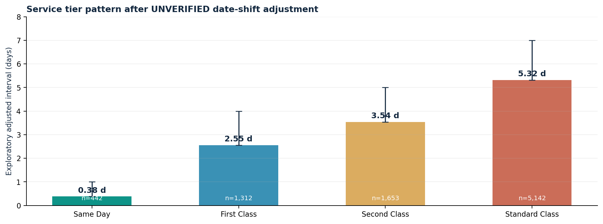

# Factory-to-Customer Shipping Route Efficiency Analysis

### Nassau Candy Distributor | Streamlit dashboard + research paper + executive summary

A complete reproducible, **educational case-study project** analyzing order-to-ship intervals for five *assignment-provided* factory locations, destinations across the US and Canada, and four shipping classes.

> **Critical data-integrity finding:** Original order dates are in 2024-2025 while ship dates extend from 2026-2030. All source intervals exceed 365 days. The dashboard distinguishes **raw recorded intervals** from an **unverified exploratory 904 / 1269 / 1634-day offset adjustment**. Its adjusted statistics must **not** be described as real Nassau Candy fulfillment, transit, on-time delivery, or shipping-cost performance.



## Deliverables

| Deliverable | Location |
|---|---|
| Streamlit dashboard | [`app.py`](app.py) |
| Offline read-only interactive preview | [`Dashboard_Preview.html`](Dashboard_Preview.html) |
| Research paper, 8-page PDF | [`reports/Research_Paper.pdf`](reports/Research_Paper.pdf) |
| Research paper editable text | [`reports/Research_Paper.md`](reports/Research_Paper.md) |
| Executive summary for public-sector stakeholders | [`reports/Executive_Summary.pdf`](reports/Executive_Summary.pdf) |
| Executive summary text | [`reports/Executive_Summary.md`](reports/Executive_Summary.md) |
| Feedback video narration script | [`reports/Feedback_Video_Script.md`](reports/Feedback_Video_Script.md) |
| Audited aggregation logic | [`analysis.py`](analysis.py) |
| Product-factory assumptions | [`factory_lookup.py`](factory_lookup.py) |
| State centroids + map codes | [`geo_lookup.py`](geo_lookup.py) |
| De-identified public demonstration data | [`data/public_demo_orders.csv`](data/public_demo_orders.csv) |
| Regression tests | [`tests/test_analysis.py`](tests/test_analysis.py) |
| Submit/deploy instructions | [`SUBMISSION_GUIDE.md`](SUBMISSION_GUIDE.md) |

## Start the dashboard locally

Use **Python 3.10+** (3.11 recommended) from this directory:

```bash
python -m venv .venv
# macOS / Linux
source .venv/bin/activate
# Windows PowerShell: .venv\Scripts\Activate.ps1
python -m pip install -r requirements.txt
streamlit run app.py
```

Streamlit will print a local address (typically `http://localhost:8501`). The case-study demo loads automatically. To analyze the original uploaded CSV privately, use the **CSV uploader in the left sidebar**. You do not need to change the source code.

> **Data sharing:** The packaged default CSV replaces order IDs and customer IDs with pseudonymous identifiers and withholds city/postal-code fields. This is data minimization, **not a formal guarantee of anonymity**. Confirm that sharing aggregated dates, finance values and geography is permitted. The original input file is not part of the public submission ZIP and `data/nassau_candy_orders.csv` is deliberately ignored by Git. Do not add private data to a public repository without authorization.

## Deploy the working Streamlit app (get required HTTPS URL)

1. Create a **public GitHub repository** named, for example, `nassau-shipping-route-analysis`.
2. Upload the **contents** of the supplied public project ZIP to the repository root; do not upload the ZIP as a single file. Make sure `app.py`, `requirements.txt`, and the `data/` folder remain in the correct relative paths.
3. Open **https://share.streamlit.io/** (Streamlit Community Cloud), log in with your GitHub account and select **Create app / New app**.
4. Choose the repository, branch `main`, and entrypoint `app.py`; click **Deploy**. Wait for Streamlit to finish installing `requirements.txt` and booting.
5. Test filters, mode and geography tabs, the order drill-down, and the `Data Quality & Methods` page on the public URL. Copy your actual deployed HTTPS address.

The offline [`Dashboard_Preview.html`](Dashboard_Preview.html) allows immediate review of five graphs without Python or Streamlit. It is **read-only and not a substitute for the deployed Streamlit link** in the submission form.

## Submit the four URLs

The submission form pictured in the assignment requires **four valid `https://` URLs**:

1. **GitHub repository link** - your new public project repo, such as `https://github.com/YOUR_USERNAME/nassau-shipping-route-analysis`.
2. **Research paper link** - the published/viewable PDF in that repo: `https://github.com/YOUR_USERNAME/nassau-shipping-route-analysis/blob/main/reports/Research_Paper.pdf`. This is a case-study paper, **not** peer-reviewed or research-journal-approved; do not claim it is.
3. **Deployed Streamlit app URL** - the actual HTTPS link generated by Streamlit Cloud after deployment.
4. **Feedback video URL** - record a 90-120 second personal voice/screen video using [`reports/Feedback_Video_Script.md`](reports/Feedback_Video_Script.md) as an optional outline, then upload to YouTube (unlisted), Loom or an accessible file sharing site.

The example URLs above are **placeholders**, not working submitted links. Verify all four links from an incognito browser before clicking **Submit URLs**. See [`SUBMISSION_GUIDE.md`](SUBMISSION_GUIDE.md).

**The URL https://www.nassaucandy.com/ is the actual distributor's retail/wholesale website, *not* the project submission platform shown in the screenshot.** The screenshot contains no submission-page web address, so the destination form itself was not accessible for automated submission.

## Dashboard modules

| Page | Purpose |
|---|---|
| Route Overview | KPI strip; top/bottom 10 volume-qualified factory-to-state rankings; relative efficiency score; monthly trends |
| Geographic Bottlenecks | US state choropleth; candidate high-volume/longer-interval states; region comparison; illustrative factory-to-state centroid connections; Canadian provinces separately |
| Shipping Mode Analysis | Same Day / First Class / Second Class / Standard Class means, distribution and delayed share; manufacturing cost caveat |
| Route Drill-Down | Factory and destination selectors; source order/ship-date plot; interval histogram; dispatch-level table and CSV export |
| Data Quality & Methods | Source validation counts, raw offset clusters, definitions, limitations and links to the official company website |

Sidebar filters: **order date range; country; region; destination state/province; assumed factory; shipping class; lead-time threshold; minimum qualified route volume; raw vs exploratory measurement; optional CSV uploader**.

## Reproducible methodology

1. Validate 18 source fields and parse source dates in `dd-mm-yyyy` with explicit date format alternatives. Check missing dates, negative lead time and unmatched products.
2. Attribute each product to the user-supplied factory, and preserve supplied factory coordinates without claiming they represent actual Nassau Candy sites.
3. Aggregate SKU lines by unique `Order ID + factory + country + state + region + ship mode + order date + ship date`; avoid counting each SKU line as a separate shipment.
4. **Raw recorded order-to-ship time** = ship date minus order date. There is no customer delivery timestamp.
5. **Diagnostic adjusted time (unverified only)** = raw time minus 904, 1269 or 1634 for any raw value in that offset's `[base, base+14]` band. Plausible 0-14-day residuals are a scenario, not a verified data repair. Otherwise the diagnostic value is missing (raw view remains available). Normal 0-14-day inputs are left unchanged.
6. Per-route KPIs: number of dispatches, mean / median, sample standard deviation, 90th percentile and threshold exceedance percentage.
7. **Relative efficiency score** = `100 x (slowest eligible mean - route mean) / (slowest - fastest mean)` for the selected, minimum-volume-qualified routes (ties score 100). Scoring is relative, descriptive, and sensitive to filters and mix.
8. **Candidate bottleneck** = customer state/province with >= median destination volume and mean above overall selection mean. Candidate status **does not establish road congestion**.

The research paper ranks factory/state routes with >=50 dispatches; the dashboard's default is >=20, adjustable by the user.

## Headline research findings (diagnostic scenario is UNVERIFIED)

| Finding | Observed result |
|---|---:|
| Original SKU lines | 10,194 |
| Unique order-factory dispatch records | 8,549 |
| Factory-state/province pairs | 196 |
| US / Canada dispatches | 8,389 / 160 |
| Raw average source interval | 1,321.37 days |
| Raw intervals longer than 365 days | 100% |
| Ship dates later than 2026-10-12 | 8,245 records |
| Diagnostic adjusted mean | **4.29 days (NOT verified)** |
| Diagnostic share above 5 days | **24.6% (NOT verified)** |
| Adjusted Same Day / First / Second / Standard means | 0.38 / 2.55 / 3.54 / 5.32 days |

The supplied `Cost` is **manufacturing cost**, not transportation cost. Source `Ship Date` is not actual delivery. As a result, a real freight **cost-time tradeoff**, transport SLA compliance, or route optimization cannot be calculated with these columns. The closest accurate description is **order-to-ship interval analysis** with a data-quality warning.

## Recreate figures, paper and quality exports

```bash
python -m pip install -r requirements-reports.txt
python scripts/generate_reports.py
python scripts/generate_preview.py
python -m pytest -q
```

This generates `reports/` PDFs/markdown/quality CSVs and `assets/` figures using the original input if kept privately in `data/nassau_candy_orders.csv`, otherwise the public demonstration CSV (aggregates and interval statistics are preserved).

`python scripts/make_public_demo.py` can regenerate a new data-minimized demo only when the original private CSV exists. Never treat this demo as formally anonymized for regulatory/compliance purposes.

## Site and evidence sources

- Official Nassau Candy site: https://www.nassaucandy.com/
- Official delivery information: https://www.nassaucandy.com/delivery-information
- Official locations/contact: https://www.nassaucandy.com/contact/
- CSV, five assumed factory coordinate pairs, and 15 product-factory associations: assignment-provided, provenance unverified.

Public materials describe physical distribution operations; they do not corroborate the five Wonka-themed factories in this educational dataset. This project has no affiliation/endorsement claim and is not a verified assessment of the distributor's performance.
