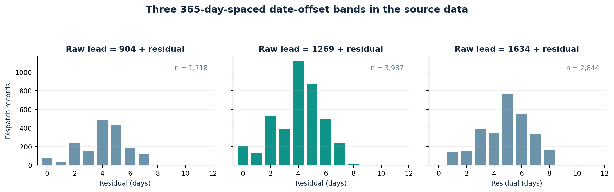
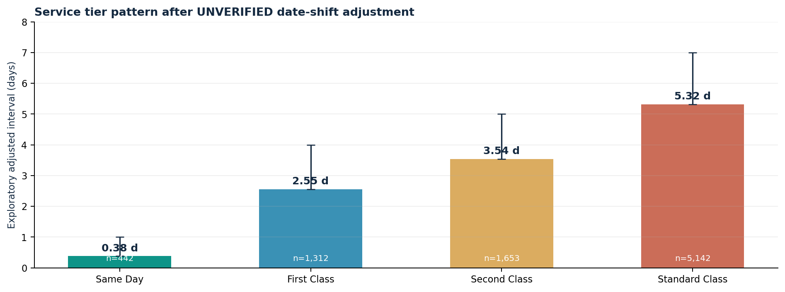
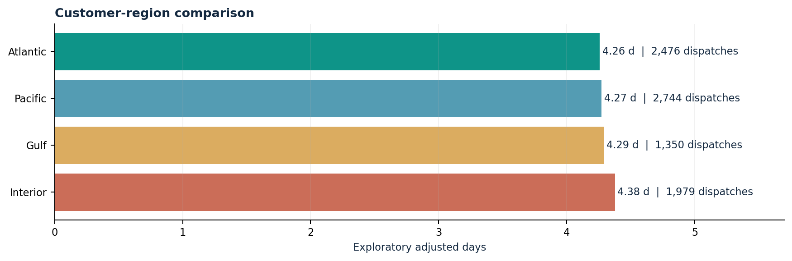
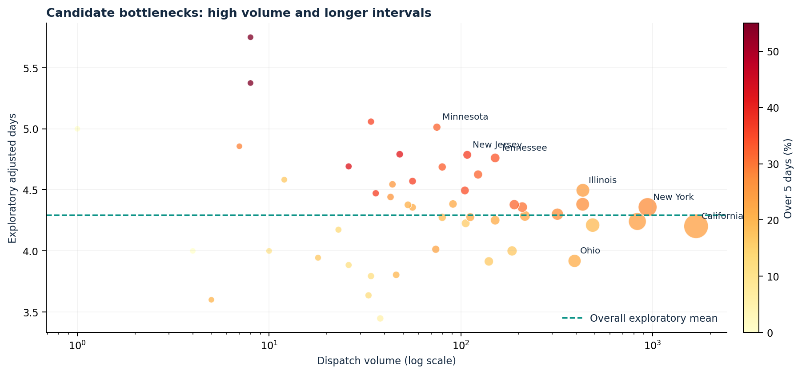

# Factory-to-Customer Shipping Route Efficiency Analysis
## Nassau Candy Distributor | Research Paper / Case Study

**Report date:** 12 October 2026  
**Data:** User-supplied `nassau_candy_orders.csv` plus a user-supplied 15-product / 5-factory mapping.  
**Status:** Exploratory descriptive study, NOT an audit of Nassau Candy operations.

## Abstract

This study builds a reproducible factory-to-destination dispatch analytics system using 10,194 SKU-level records, representing 8,549 distinct order-factory dispatch records. It includes validation, a US shipping-efficiency choropleth, four-service-tier comparison, minimum-volume route benchmarking, a route drill-down, and an explicit assessment of whether the available dates support logistics conclusions. The predominant finding is data integrity: source orders occurred during 2024-01-02 to 2025-12-31, while recorded ship dates range 2026-06-30 to 2030-06-28. All 8,549 dispatches have a source interval above 365 days and 8,245 are future-dated as of the report's reference date. Consequently raw durations cannot credibly represent ordinary fulfillment or delivery.

A **clearly unverified sensitivity adjustment** reveals three intervals offset by exactly 365 days: subtracting 904, 1,269, or 1,634 days when the remainder is 0-14. On this assumed residual scale, the mean is 4.29 days and 24.6% exceed five days. These figures are hypotheses for validation, **not verified customer delivery KPIs**.

## 1. Research problem and questions

A distributor needs to understand which origin-destination corridors have larger dispatch intervals, how modes differ, and which high-volume destinations merit investigation. Questions: (Q1) How do order-to-ship intervals vary by factory/state/region? (Q2) Which routes rank fastest/slowest at sufficient volume? (Q3) Are candidate hotspots associated with greater volumes and longer intervals? (Q4) Which data deficiencies prevent credible route-cost or on-time-delivery decisions?

## 2. Dataset and integrity assessment

- **Original grain:** SKU/order line (`Row ID`); 10,194 rows, 18 columns, 15 products.
- **Dispatch grain:** unique `Order ID` x factory x destination x ship mode x original order/ship dates; 8,549 records. This prevents double counting lines from the same order.
- **Geography:** 8,389 US dispatch records; 160 Canadian records. The US map excludes Canada; Canadian results remain in tables.
- **Quality:** 0 invalid/missing dates; 0 negative durations; 0 unmapped product lines; 0 excluded lines.
- **Severe quality issue:** raw lead-time mean 1321.37 days; dates reflect multi-year offsets; all raw intervals exceed 365 days. Future-dated records: 8,245 / 8,549.

The source shows clusters centered at 904, 1269 and 1634 days. The recurrence and mode-aligned residuals suggest a systematic date transformation or synthetic-data mechanism. This is an **inference**, not documented source truth. The unmodified raw series remains accessible in the dashboard.

## 3. Methods and operational definitions

1. Parse dates as `%d-%m-%Y` (with explicit ISO/slash fallbacks); standardize geography, map 15 product names to five *case-study* factories, check null, negative and unmapped records.
2. Aggregate repeated SKU lines into a unique order/factory/destination/dispatch record, summing units and manufacturing financials.
3. Define route = factory to customer state/province; region summaries group by supplied four geographic categories. No carrier trip itinerary is available.
4. Compute **raw order-to-ship lead time** = Ship Date - Order Date, in calendar days. This is fulfillment processing / date-to-dispatch interval, NOT ship-to-delivery transit time.
5. Exploratory only: for raw intervals in `[904,918]`, `[1269,1283]`, or `[1634,1648]`, subtract respective base; plausible 0-14-day residuals are labeled *diagnostic adjusted days*. This rule is case-specific, not production-ready date repair.
6. Compare mean, median, sample SD, 90th percentile and fraction strictly above analyst-configured threshold. Five adjusted days is used for research; not an official service level.
7. Benchmark eligible routes with >=50 dispatches for these research tables (dashboard defaults to 20, adjustable). Relative score = `100 * (max eligible mean - route mean) / (max eligible mean - min eligible mean)`; ties score 100. Scores reflect only this sample and selected view.
8. Define *candidate bottlenecks* as destinations with at least the median state/province volume and mean above the dataset-level mean. Neither correlation nor straight-line map connections establishes real highway congestion.

## 4. Findings: mode, region, route rankings

### 4.1 Shipping class comparison - adjusted scenario only

| Ship mode | Dispatches | Mean residual days | Over 5 days |
|---|---:|---:|---:|
| Same Day | 442 | 0.38 | 0.0% |
| First Class | 1,312 | 2.55 | 0.0% |
| Second Class | 1,653 | 3.54 | 6.7% |
| Standard Class | 5,142 | 5.32 | 38.8% |

The adjusted tier ordering is plausible (same-day shortest, standard longest) but this consistency is *not proof* of valid shipping timestamps. Claims about carrier SLA compliance cannot be made.

### 4.2 Region comparison - adjusted scenario only

| Customer region | Dispatches | Mean residual days | Over 5 days |
|---|---:|---:|---:|
| Atlantic | 2,476 | 4.26 | 23.5% |
| Pacific | 2,744 | 4.27 | 25.2% |
| Gulf | 1,350 | 4.29 | 24.0% |
| Interior | 1,979 | 4.38 | 25.5% |

Differences between region averages are relatively small. Mix of shipping modes, products, customer concentrations, date cohorts and factory assignments may confound these crude means.

### 4.3 Top 10 eligible factory-state routes (>=50 dispatches)

| Rank | Route | Dispatches | Mean days | Over 5 days |
|---:|---|---:|---:|---:|
| 1 | Lot's O' Nuts -> Ohio | 218 | 3.90 | 23.4% |
| 2 | Lot's O' Nuts -> Virginia | 91 | 3.91 | 14.3% |
| 3 | Wicked Choccy's -> Ohio | 157 | 3.96 | 19.7% |
| 4 | Lot's O' Nuts -> Massachusetts | 58 | 4.00 | 13.8% |
| 5 | Lot's O' Nuts -> Colorado | 82 | 4.05 | 22.0% |
| 6 | Lot's O' Nuts -> California | 944 | 4.12 | 24.0% |
| 7 | Wicked Choccy's -> Georgia | 55 | 4.13 | 21.8% |
| 8 | Lot's O' Nuts -> Pennsylvania | 270 | 4.14 | 16.3% |
| 9 | Wicked Choccy's -> Virginia | 85 | 4.19 | 20.0% |
| 10 | Lot's O' Nuts -> Michigan | 118 | 4.20 | 26.3% |

### 4.4 Bottom 10 eligible factory-state routes (>=50 dispatches)

| Rank | Route | Dispatches | Mean days | Over 5 days |
|---:|---|---:|---:|---:|
| 1 | Lot's O' Nuts -> New Jersey | 53 | 4.92 | 41.5% |
| 2 | Wicked Choccy's -> Tennessee | 56 | 4.84 | 32.1% |
| 3 | Lot's O' Nuts -> Tennessee | 88 | 4.73 | 33.0% |
| 4 | Wicked Choccy's -> Michigan | 83 | 4.59 | 34.9% |
| 5 | Wicked Choccy's -> Illinois | 183 | 4.56 | 27.9% |
| 6 | Lot's O' Nuts -> Illinois | 235 | 4.52 | 23.0% |
| 7 | Lot's O' Nuts -> Indiana | 74 | 4.47 | 28.4% |
| 8 | Lot's O' Nuts -> Oregon | 62 | 4.45 | 32.3% |
| 9 | Lot's O' Nuts -> Arizona | 94 | 4.41 | 29.8% |
| 10 | Lot's O' Nuts -> Washington | 230 | 4.38 | 25.2% |

These ranks are **sensitivity results**, not confirmed supply-chain bottlenecks. They depend on a synthetic-looking date adjustment; low-sample routes are excluded. Rankings are not adjusted for mode mix or seasonal cohorts.

## 5. Geographic bottleneck candidates

State/province candidates are selected by above-median volume and above-overall mean adjusted interval. Highest delay-rate candidates in the selected set include:

| State/province | Dispatches | Mean days | Over 5 days |
|---|---:|---:|---:|
| Arkansas | 48 | 4.79 | 41.7% |
| New Jersey | 108 | 4.79 | 36.1% |
| Oklahoma | 56 | 4.57 | 35.7% |
| Oregon | 105 | 4.50 | 34.3% |
| Tennessee | 151 | 4.76 | 33.1% |
| Delaware | 80 | 4.69 | 32.5% |
| Minnesota | 75 | 5.01 | 32.0% |
| Indiana | 123 | 4.63 | 31.7% |
| Arizona | 190 | 4.38 | 31.6% |
| Michigan | 209 | 4.36 | 30.1% |

## 6. Cost-time tradeoff and limitations

A valid **shipping-cost-to-speed** analysis is NOT possible: `Cost` represents manufacturing cost, `Gross Profit = Sales - manufacturing Cost`, and the file contains no freight charges, distance, carrier, freight weight, actual delivery date, or promised service deadline. The source `Ship Date` marks dispatch, not customer receipt. The assignment's five Wonka-themed factories are not documented operating Nassau Candy facilities. The real company's public delivery page describes distribution facilities in multiple US states, but it does not validate the source factory mapping. Date-shift arithmetic does not restore trustworthy source provenance.

This is descriptive EDA with no causal identification, road-distance optimization, statistical confidence inference, service-level compliance conclusion, or customer complaint data. State-centroid lines are illustrations, not road routes. Canadian destinations are intentionally omitted from the US choropleth and assessed separately.

## 7. Recommendations and validation sequence

1. **Block production decisions** based on this file's current dates; request source-system shipment timestamps and original extract specifications.
2. **Reconcile** a stratified sample of orders across raw shipping records, carrier scans and customer proof-of-delivery. Check the three suspected date shifts before any correction is accepted.
3. **Add required inputs:** true origin facility ID, delivery timestamp, promised date, carrier, freight amount, weight, miles, dispatch status, and reason codes for exception management.
4. **Pilot weekly route/region monitoring** after validation: mode-mix-adjusted order-to-dispatch time, actual ship-to-delivery time, on-time percentage, delay distribution, and freight cost per unit/order.
5. **Investigate candidates** (e.g., state clusters with higher delay rates and meaningful volumes), using controls for service mix and demand periods rather than treating raw rank as operational fault.
6. **Govern US and Canada separately** for maps, crossing rules and realistic carrier service policies.

## 8. Conclusion

The work provides a deployable, transparent Streamlit analytical foundation and reveals a critical date-quality issue. A 4.29-day diagnostic average is consistent with a plausible hypothetical date-shift repair but must not be represented as Nassau Candy's measured delivery performance. After source reconciliation and addition of carrier/delivery fields, the system can support verified lane-level monitoring and operational decisions.

## References and provenance

1. User-provided CSV, `Nassau Candy Distributor (1).csv`, made available for this project; no independent provenance information.
2. User-provided assignment product-to-factory mapping and five geographic coordinates; treated solely as case-study assumptions.
3. Nassau Candy official website, https://www.nassaucandy.com/ (accessed 12 October 2026).
4. Nassau Candy, Delivery Information, https://www.nassaucandy.com/delivery-information (accessed 12 October 2026).
5. Nassau Candy, Contact / Distribution Centers, https://www.nassaucandy.com/contact/ (accessed 12 October 2026).

## Reproducibility

`pip install -r requirements-reports.txt`, then `python scripts/generate_reports.py` to regenerate these documents, export tables, and charts. Run dashboard with `streamlit run app.py`; tests: `python -m pytest -q`.
